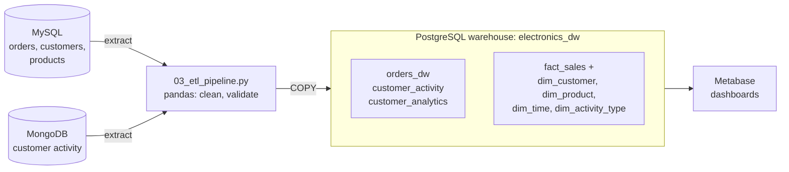

# Business intelligence pipeline: online electronics retail

[](https://github.com/Gael-Majestic/Business_Intelligence_Mini_Project/actions/workflows/ci.yml)

Coursework for the DMS580S module (CPUT, 2026). The operational data of an online electronics
retailer is held in two sources: MySQL for orders and MongoDB for customer activity. A Python ETL
script extracts it, cleans it and loads it into a PostgreSQL warehouse with a star schema, which
Metabase queries for dashboards.



## Run it

Requires Docker with Compose, and Python 3.12.

```bash
docker compose up -d --wait        # MySQL, MongoDB, PostgreSQL and Metabase; each database seeds itself
pip install -r requirements.txt
python 03_etl_pipeline.py          # extract → transform → load
```

The script's defaults match `docker-compose.yml`, so it needs no settings. The databases create
their schemas and sample data on first start (the SQL and JavaScript files are mounted into
`/docker-entrypoint-initdb.d`), and `--wait` returns only when every seed has finished.

Then explore the results:

```bash
# the business queries (sections 4 and 5 of the warehouse script)
sed -n '/SECTION 4/,$p' 04_postgresql_dw.sql | docker compose exec -T postgres psql -U admin -d electronics_dw
```

Metabase runs at http://localhost:3000. Add a PostgreSQL database with host `postgres`, port `5432`,
database `electronics_dw`, user `admin` and password `adminpass`.

The passwords are local demonstration values (override them in a `.env` file), and every port is
published on `127.0.0.1` only. `docker compose down` stops everything and keeps the data;
`docker compose down -v` deletes it.

## What the pipeline does

| Step | What happens |
|---|---|
| Extract | MySQL: the denormalised `v_orders_export` view, plus the `customers` and `products` master tables for the dimensions. MongoDB: every document of `customer_activity`. All written to CSV. |
| Transform | Column names in snake_case, rows missing a critical field dropped, dates and amounts typed and formatted, MongoDB `_id` removed, invalid activity values dropped. The run stops if fewer than 30 orders or 15 activities remain (business rule BR-09). |
| Load | One transaction: truncate, `COPY` the clean data into `orders_dw` and `customer_activity`, build `customer_analytics`, then fill the star schema. The run fails if any order finds no matching dimension row. |

Business rules, column definitions and KPIs are in the [data dictionary](06_data_dictionary.md); the
star schema is drawn in [`05_star_schema.html`](05_star_schema.html) (open it in a browser).

## Files

| File | Contents |
|---|---|
| `01_mysql_oltp.sql` | MySQL source `electronics_retail`: schema, sample orders and the export view |
| `02_mongodb_seed.js` | MongoDB source `electronics_retail_behavior`: customer activity events |
| `03_etl_pipeline.py` | The ETL (pandas): extract, transform, load |
| `04_postgresql_dw.sql` | Warehouse `electronics_dw`: core tables, star schema and 11 business queries |
| `05_star_schema.html` | Diagram of the star schema |
| `06_data_dictionary.md` | Data dictionary, business rules and KPIs |
| `docker-compose.yml` | MySQL, MongoDB, PostgreSQL and Metabase; a `cluster` profile adds a second MySQL node and a small Hadoop cluster from the module, which the ETL does not use |
| `tests/` | Unit tests of the transform step (no database needed) |

## Tests and CI

```bash
pip install -r requirements-dev.txt
pytest                 # unit tests of the transform functions
ruff check . && ruff format --check .
```

[GitHub Actions](.github/workflows/ci.yml) runs three jobs on every push:

- **Lint and unit tests.**
- **End-to-end pipeline:** starts the databases with Compose, runs the real ETL, checks the row count
  of every warehouse table, runs the ETL a second time to prove that re-runs replace data instead of
  duplicating it, executes all 11 business queries (their output is in the run's summary), and
  starts Metabase.
- **Hadoop profile:** the NameNode and DataNode start, the DataNode registers, and a file can be
  written to and read from HDFS.

The October 2026 revision (self-seeding Compose setup, star-schema load, tests and CI) was made with
the help of Claude, an AI assistant, and reviewed by me.
